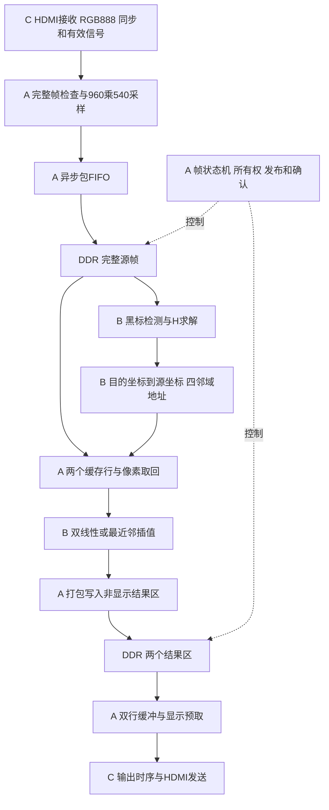
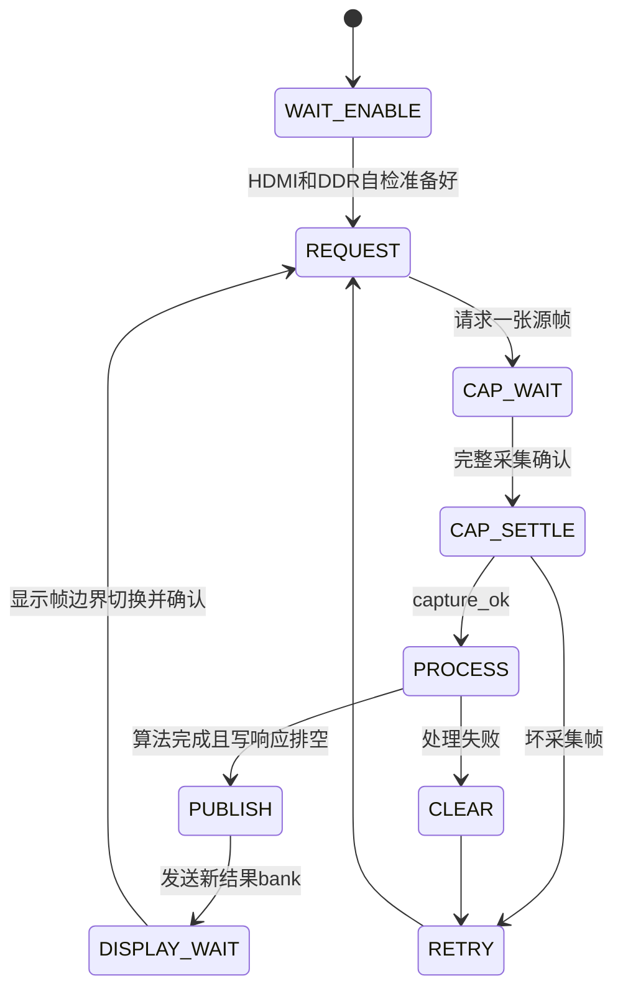

# 当前系统接口与数据流程

本页依据旧黑标873cb996的实际编译源码，补充早期接口v1的尺寸与颜色差异，供A与B C核对。它不是已经共同签认的新版本规格。

## 真实数据流

## 当前参数

| 项目 | 旧黑标工程中的值 | A需要理解的含义 |
|---|---|---|
| 输入承载 | 1920×1080 RGB888 | C提供真实有效区和同步 |
| 算法源图 | 960×540 | 从输入每2个水平和垂直像素采一个 |
| 结果图 | 640×904 RGB888 | 完整结果578560像素 |
| HDMI扫描 | 1920×1080 | 结果窗口位于x640 y88 SCALE为1 |
| 算法时钟 | 27MHz | B接口和frame_processor均在此域 |
| 显示时钟 | 148.5MHz | 固定扫描节奏 不能等待算法 |
| 配置时钟 | 10MHz | HDMI芯片配置 |
| DDR参考及UI | 125MHz | 按现有IP和约束配置 与显示域分开 |
| 接收像素时钟 | 外部hd_rx_pclk | 实际视频模式由C核对 |
| 黑阈值 | RGB各0到64 | 不是全画面连通域跟踪 |
| 角标身份 | 四个固定ROI TL TR BR BL | 同样的黑块靠所在窗口决定身份 |
| 坐标请求额度 | 16 | 在发出目的请求时预留空间 |
| 输入FIFO | 285位×1024项 | 1位采集token 28位字地址 256位像素包 |

## 从像素地址到DDR

源像素按行排列，逻辑地址为addr=y×960+x。B已经给出四邻域的24位像素索引，A将其转换为28位DDR字地址。当前每像素占32位，格式为8位0加24位RGB，8像素组成256位beat。

举例：源坐标为123.5和217.25时，四邻域整数地址为208443、208444、209403、209404；fx为128、fy为64。第一个地址的8字对齐地址是208440，lane是3。缓存用lane×32选出其中24位RGB。

容量计算可用字节，但此引擎的cmd_addr和axi地址端口使用32位字地址，不能再次乘4。也不能沿用RGB888三字节紧密排列的偏移。

| 区域 | 基址 单位为32位字 | 用途 |
|---|---|---|
| 源帧 | 0x0000000 | 一张处理期间保持不变的源图 |
| 结果0 | 0x0100000 | 一张完整结果 |
| 结果1 | 0x0200000 | 另一张完整结果 |
| 启动自检 | 0x03f0000 | 默认256个beat的已知图案测试 |

## 一笔算法请求的生命期

1. A发出dst_valid及目的x/y，并预留一个额度。
2. B在坐标流水线完成后产生req_valid，给出inside、tag、fx/fy和四个地址。
3. A保存全部元数据。inside为1才读内存；inside为0也按序产生一次黑色响应。
4. A把同一请求的四邻域与原tag、原权重一起交回B。
5. B输出out_valid、out_rgb和out_tag，A检查位置并写入目的区。
6. 只有结果写入真正被接受才归还该像素额度；整帧完成还要等最后DDR写响应排空。

B没有ready，A不能临时丢掉已发出的请求。DDR命令有valid/ready握手；被接受前地址和负载必须保持。两种接口的节拍不同。

## 源帧与结果帧如何切换

当前只有一块源帧区，采集和处理按帧顺序进行；结果区双缓冲让显示不受处理节拍直接影响。它能保护完整帧，但不意味着每一张相机输入都被处理。角标失败后旧结果继续显示，因此静止旧图不证明算法仍在运行。

## 时钟与复位要一起核对

连续输入跨到UI使用异步FIFO；27MHz处理命令跨到UI使用请求响应邮箱；显示行缓冲用完成确认保护写域和读域。多个bit不能各自随便打两拍就当成整包安全。

reset_sync负责各域同步释放。启动还要满足PLL锁定、DDR初始化、自检及HDMI配置完成。严重内存异常和晚到响应要核对复位范围，不能只复位B的数学模块。

## 已确认与仍待确认

RGB顺序、地址布局、尺寸、算法tag、请求顺序和结果发布条件可从冻结源码确认。HDMI外部延迟仍是初步板级模型，真实更新率、端到端延迟、角标几何校准和长期稳定性仍需队友提供现场证据。

主要依据：[video_correct_ddr_top.v](<C:/D/FPGA/video_correct_integrated_20261008/A_tasks_20261014/02_system/video_correct_ddr_top.v:4>)、[video_correct_ddr_core.v](<C:/D/FPGA/video_correct_integrated_20261008/A_tasks_20261014/02_system/video_correct_ddr_core.v:5>)、[frame_session.v](<C:/D/FPGA/video_correct_integrated_20261008/A_tasks_20261014/02_system/frame_session.v:5>)、[frame_processor.v](<C:/D/FPGA/video_correct_integrated_20261008/A_tasks_20261014/02_system/frame_processor.v:8>)、[ddr_pixel_cache.v](<C:/D/FPGA/video_correct_integrated_20261008/A_tasks_20261014/02_system/ddr_pixel_cache.v:8>)、[ddr_result_writer.v](<C:/D/FPGA/video_correct_integrated_20261008/A_tasks_20261014/02_system/ddr_result_writer.v:5>)、[interfaces.md](<C:/D/FPGA/video_correct_integrated_20261008/A_tasks_20261014/03_partner_reference/B/interfaces.md>)、[board_ddr.fdc](<C:/D/FPGA/video_correct_integrated_20261008/A_tasks_20261014/02_system/board_ddr.fdc>)。
