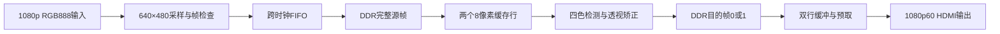

# DDR 视频矫正工程

本版本已经接入实际 DDR3 控制器、完整源帧采集、B 的算法、目的帧存储与显示预取。实体 DDR 校准、HDMI 画面和持续运行验证需要连接开发板后进行。使用 `video_correct_ddr_top`；原 BRAM 版本继续保留作为上板对照。

## 数据路径

## 固定配置

|项目|配置|
|---|---|
|芯片/封装|PG2L100H / -6 / FBG676|
|HDMI输入|1920×1080 RGB888，1080p60基线|
|算法源图|640×480|
|采样位置|源第(x,y)像素取输入(floor(x×1920/640),floor(y×1080/480))|
|目的图|320×452，RGB888|
|显示|1920×1080，148.5 MHz，标称60 Hz|
|窗口|最近邻2倍放大至640×904，左上角(640,88)，外侧黑色|
|处理时钟|板载27 MHz，B全部接口在此域|
|DDR时钟|U7差分125 MHz参考；UI 125 MHz，CK 500 MHz / 1000 MT/s|
|视频/配置时钟|独立148.5 MHz PLL / 10 MHz PLL|
|HDMI控制|MS7200先初始化，再MS7210；SDA开漏，ACK错误闭锁指示|

这是完整帧计算方式。HDMI扫描保持60 Hz，没有新结果时重复旧图；结果更新速度由采集、算法和DDR访问共同决定，不能把60 Hz扫描当作每秒60张新矫正结果。

## DDR地址与归属

所有DDR地址单位均为32位word，一个RGB888像素占一个word：`[23:0]=RGB`，`[31:24]=0`。单个控制器数据beat为256位/8个word/32字节。块地址低3位为0，相邻块地址增加8；转换字节地址需乘4。

|区域|起始word地址|起始byte地址|使用大小|
|---|---:|---:|---:|
|源帧|0x0000000|0|307,200 words / 1,228,800 bytes|
|目的帧0|0x0100000|4,194,304|144,640 words / 578,560 bytes|
|目的帧1|0x0200000|8,388,608|144,640 words / 578,560 bytes|
|启动自检|0x03F0000|16,515,072|256 beats / 8,192 bytes|

这里的目的“帧0/1”是两个地址区域，与DDR颗粒的内部bank编号没有直接对应关系。

源图仅在收到请求后采集一次。源采集FIFO深度512包，每包含请求token、word地址和8像素。输入仍会继续到来，处理期间忽略其他帧。采集检查每行宽度、整帧行数、采样数和FIFO溢出；完整/失败帧均在已入队写入全部响应并且FIFO稳定为空后才确认，防止尾部写入未完成就开始算法读取。

B检测使用这张锁定源图的DDR回读像素，再提交同帧H并遍历目的坐标。一次只允许一笔目的像素请求在途，四邻域逐一读取并随原tag、fx/fy返回；越界请求仍完成黑色响应。源缓存是两个全相联8像素缓存行，新源帧开始时失效。最近邻模式只读一次源像素。

目的帧写入按8像素打包。处理器接受最后一个像素后，仍要等最后一个DDR写响应完成才发布。显示只读取完整目的区域，在帧边界切换；确认后才能写另一结果区域。失败帧不发布，旧图继续显示。

## 显示和跨域

UI仲裁优先级为显示预取、源采集写入、处理器读写。单个DDR事务引擎只保留一笔读或写，AW/AR等ready，写在wready拍消费，读在rvalid拍抓取。控制器没有wvalid或rready。

处理器与UI之间使用一个请求/响应toggle邮箱，数据在整个握手期间保持稳定。输入使用Gray指针FIFO。显示以两个320像素行缓冲交替读取和填充，消隐期预取行0，在当前行开始时预取下一行。行完成后才可扫描，迟到行整行黑色并置欠载标志，扫描中不会把半行黑色换成半行新数据。

显示模块内RGB/HS/VS/DE对齐延迟2拍，再经板顶输出寄存1拍，总计3个像素时钟。KEY0共同复位；各域同步释放，DDR引擎/桥接/FIFO的复位一起取消旧事务。DDR超时或格式异常会闭锁新命令，需KEY0共同复位，迟到响应不能混入新请求。

## 板级核对

DDR信号71个引脚来自本机官方硬件手册；参考时钟为N3/N2、1.5V差分输入。R5承载CA/reference，四组DQ/DQS均属于R4，依据为 [Pango PG2L100H-FBG676封装表](https://www.pangomicro.com/en/uploads/91285046_1729131914.pdf) 第21–23页。Pango生成器先登记CA，所以bank index0为R5、index1为R4，四组DQ必须使用index1。

`constr/board_ddr.fdc`移除了示例的unused标记与其他测试顶层端口，保留DDR SSTL、VREF、termination参数。参考/校准/串行PHY时钟隔离沿用厂商规则；125 MHz控制器与CA/DQ四分频数据时钟保留关联、生成边沿、2周期路径和0.4 ns不确定度，不以异步例外跳过这几组数据通路。外部HDMI延迟仍是C交接的初步板级模型，实体接口需要实测。

内存时序采用CK=2 ns：CL7/CWL6，RCD/RP=14 ns、RAS=38 ns、RC=50 ns、WR=16 ns、RFC=300 ns、REFI=7.8 μs。tFAW已修为26 CK=52 ns。生成代码MR0中的数值6是物理CL7的编码。参数和来源见 `docs/ddr_ip_notes.md`。

## 已验证范围

1. DDR单事务引擎：地址/写数据等待、同拍握手、RID/RLAST、超时闭锁、迟到响应及复位。
2. 像素缓存与辅助模块：命中替换、跨基址、byte顺序、桥接、三路仲裁、目的打包和启动自检的正常/错误回读。
3. 非整数比例采样、完整/短行/短帧、FIFO溢出和失败帧排空后确认。
4. 四个异步时钟整机仿真：完整源DDR内容、逐像素显示、写响应后才发布、活动帧保护、坏帧保持和复位恢复，无正常显示欠载。
5. 实际SRC640×480 / OUT320×452单帧：144,640个输出全部匹配fixed参考，18,080个目的beat的地址/补零/strobe正确。记录6,829,350个27 MHz周期，模型时间约252.94 ms；模型不包含真实PHY校准和全部跨域/显示争用，不能直接换算实测帧率。

测试记录在 `results/ddr_memory`、`results/ddr_capture_tests`、`results/ddr_core_e2e`、`results/ddr_fixture`、`results/ddr_display`。最终器件报告和码流以归档清单为准。

## 实测入口

先供电并连接USB/JTAG，核对器件链和最终码流SHA256；使用临时CRAM下载。LED0为心跳，LED1为DDR初始化完成，LED2为启动自检通过，LED3为已有结果，LED4为帧错误/等待超时，LED5为显示欠载，LED6为I²C/DDR/校准/自检故障，LED7为HDMI RX/TX控制器完成。

将输入设备接HDMI IN，HDMI OUT接显示器或采集卡。先回放 `results/ddr_fixture/hdmi_replay_1920x1080.png`，与 `expected_320x452.png`核对；再用相机拍摄四色纸张，并检查缓慢移动、缺角、复位和持续运行。现场读写、分辨率、图像和吞吐记录补齐后，才完成实体工程验收。
