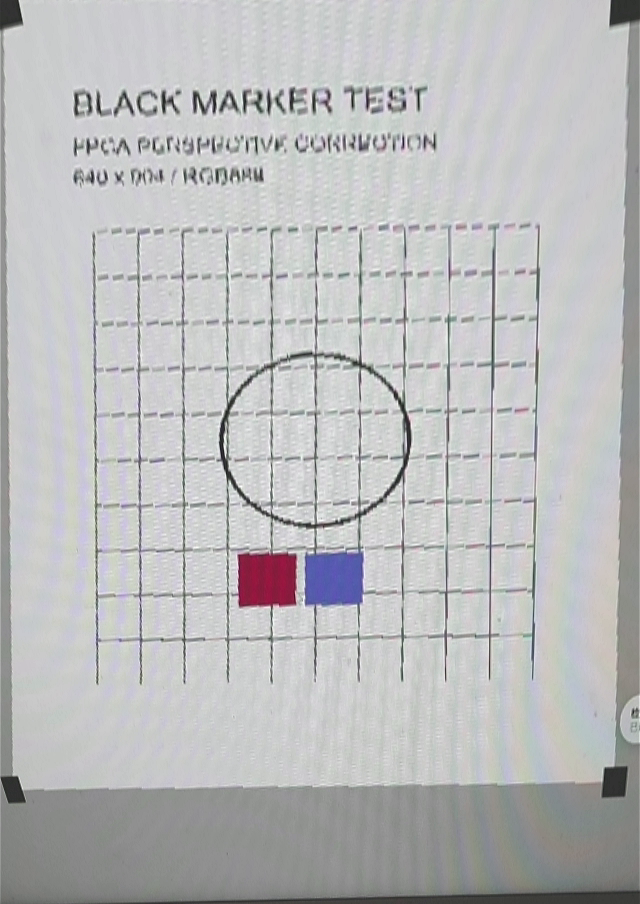
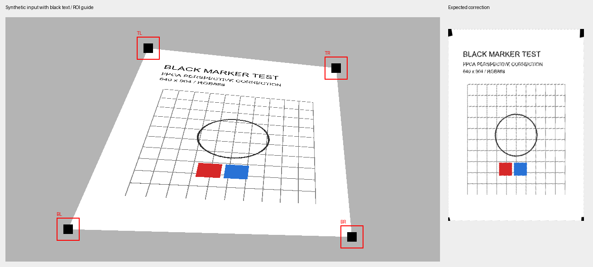

# 黑色角标校正：当前可展示成果

真实上板演示视频和截图来自2026年10月14日01:14:46保存的旧黑标版873cb996录像，物理链路为相机→FPGA→采集卡。演示保留完整640×904处理区域，包括底部灰边和轻微歪斜；只去除了HDMI外围黑色区域。它证明曾经通过FPGA显示完整黑标纸页，不能证明新版实拍速度或精确几何完成。

[旧版真实上板演示视频](黑标校正_旧版真实上板演示.mp4)

提速版39574d43已经生成并通过真实Program/Verify，未写Flash。17项Python模型、9项原生算法、16项系统检查和578560个完整RGB像素对照通过，最终时序通过。优化包含四个检测区域扫描、两级缓存、读取/插值/写入重叠。同一模拟内存模型下456.1→236.8ms，处理时间缩短48.1%；这是仿真数据。

当前实拍速度对照尚未通过：用户确认计数源在变化，提速版两次探测输出却像素完全相同；旧版重载后仍为彩条。还需检查相机原始取景与固定检测窗口、输入状态。现在板上为对照重载的旧黑标版。新版不能声称已经达到实时30fps或任意0～360°角度。

原视频、发布文件和源码封存均保留。来源、程序下载回读记录及各展示文件SHA256见“成果证据.json”。
